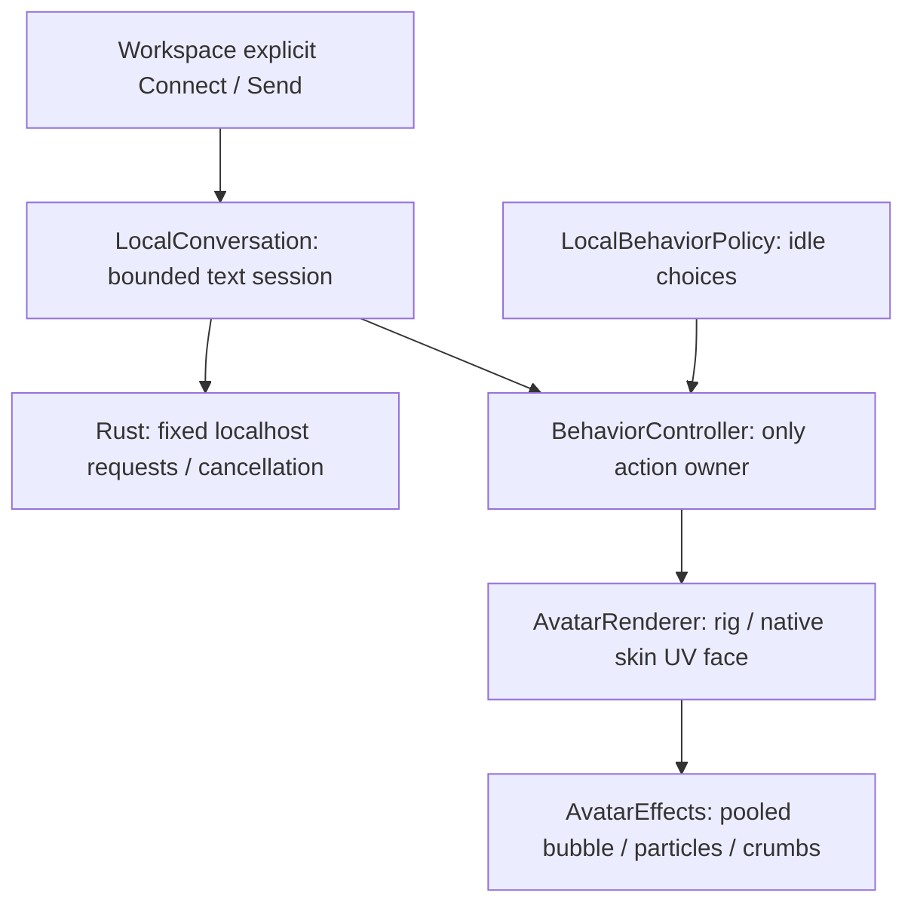

# V6.2 baseline audit — M0

Live main verified on 2026-10-14 UTC: `e73541b6cf067d0185d1f987720b9194d9b4c6b9` (V6.1 PR #12). No newer main commits. Development branch: `dev/v6-2-expressive-dual-model-intelligence`. No AGENTS.md found.

`npm ci` and `npm run check`: 139/139 tests pass; production build passes. Existing bundle-size warning (~602 kB JS) predates this work. Browser baseline initially blocked by the first CDN; alternate endpoint installed Chromium. Baseline production smoke then passed Workspace/overlay, shader pixel gates and ephemeral chat interactions. Native Windows/GPU baseline cannot be measured in this Linux container.

## Source ownership before editing

Workspace and overlay each render their own scene and BehaviorController. Only Workspace owns chat and invokes native Ollama commands; native code enforces its window label. Existing cross-window events cover settings and manual wave. V6.2 adds allowlisted request/reaction status only, without conversation content.

Animation registry includes 17 actions, nod and shrug already exist, think is finite (3.2 s). Inertial offsets preserve position and velocity; read/sit transitions stage stand-up. Idle selection, gaze, blink and activity timelines advance on the existing update/frame clock. Existing thought bubble visibility follows finite think, so it needs a separate request presentation channel. Effects have one geometry/material pool and disposal. Face is an inner-head UV shader clone with conservative swatch detection and hat occlusion; contrary to historical wording, live source uses native UV eyes, not separate 3D iris meshes. Preserve this actual architecture rather than reinstating older geometry.

V6.1 bridge uses reqwest no_proxy, no redirects, fixed 127.0.0.1:11434, size/role/model validation and cancellable requests. UI renders textContent, session history is six turns in memory, no vision or OS tools. Windows NSIS workflow builds exact PR head and hashes installer, but lacks explicit Rust unit tests. V6.2 will add that gate.

## Planned ownership

LocalConversation remains inference/session owner. ConversationReactionCoordinator is a finite presentation policy (request IDs, cooldowns, quiet clock), never a second action queue, inference loop or scheduler. BehaviorController retains all pose channels and receives bounded intents. AvatarEffects samples request/bulb presentation in the existing frame, and the face shader samples a safe upper eyelid channel. Overlay consumes small versioned TTL cues only. Manual actions suppress reply choreography for that request. M4 selected-image trial is deferred until core native/hardware gates can be certified.
