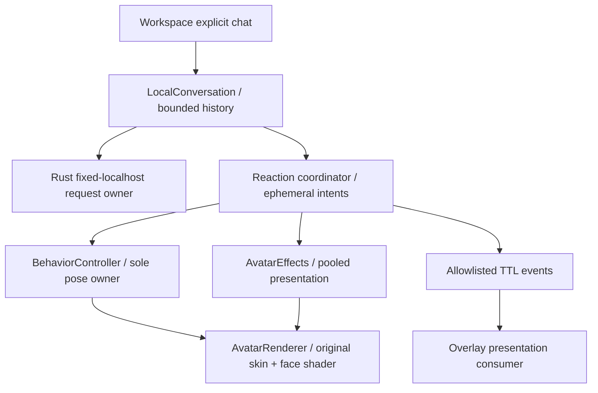
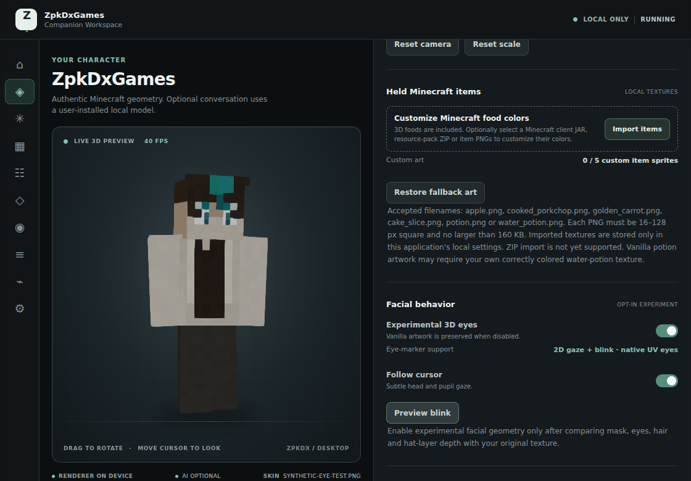
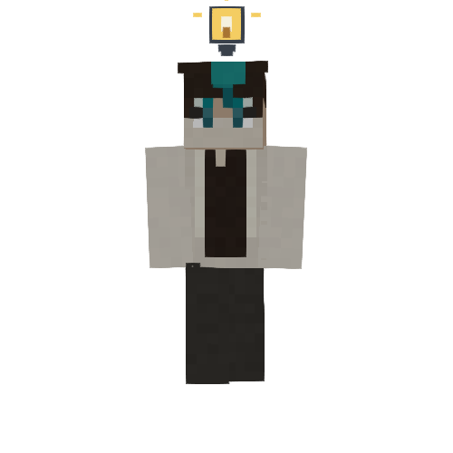
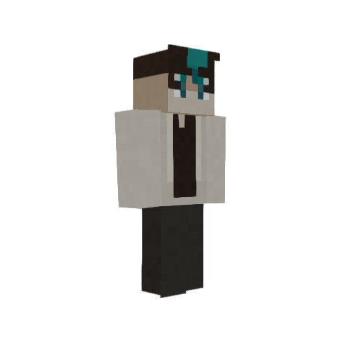
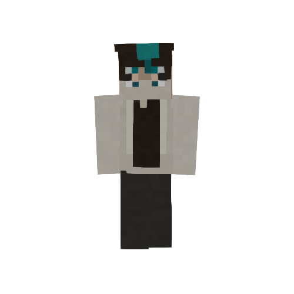
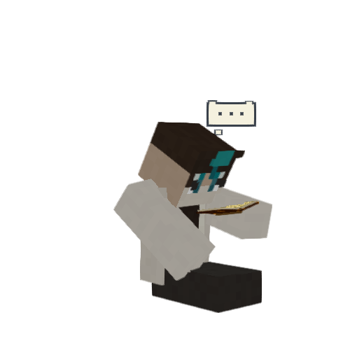
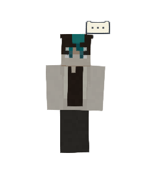
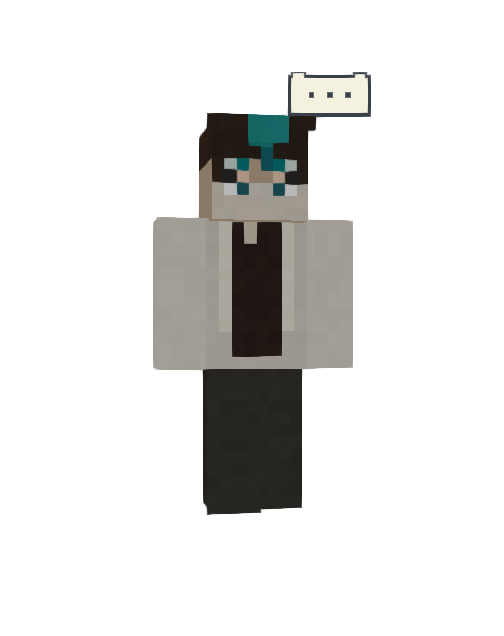

# V6.2 implementation and acceptance report

## Status and provenance

Development implementation, **not native/hardware-certified**. Verified base `main`: `e73541b6cf067d0185d1f987720b9194d9b4c6b9`. Branch: `dev/v6-2-expressive-dual-model-intelligence`. Main remains unchanged. Exact tested source is the draft PR head, also recorded in the Windows artifact's BUILD_INFO; no stable release is created.

M0 audit: [baseline ownership/source map](V6_2_BASELINE_AUDIT.md). V6.1 baseline: 139/139 source tests, successful build and actual production browser smoke. Historical docs which said Ollama was disabled were superseded by the live merged V6.1 code. Actual face rendering is a native-UV head shader, not a separate eye mesh; preserved it rather than reviving old geometry.

## Delivered code

- `local-conversation.js`: constrained reply/reaction schema; bounded parser, fenced JSON and reasoning-tag stripping; V6.1 gesture compatibility; plain text/invalid metadata neutral; memory-only six-turn history with 11,000-character request budget. One inference owner and one active request; no autonomous inference.
- `reaction-coordinator.js`: finite generating/idle/manual-preview state, monotonic request IDs, cooldown/repetition policy, stale/double completion rejection, request expiry and deterministic inactivity. Sampled from the existing frame; no timers or action queue. Pointer activity wakes smoothly even during continuous movement. Presentation events carry no user content.
- `animation-handlers.js`, `animation.js`, `motion-polish.js`: one canonical `shake` (18 total actions) with restrained decaying yaw, secondary roll/torso movement and existing inertial position/velocity continuity; bounded additive sleepy sag. Existing nod/shrug/read/eat/drink handlers retained.
- `avatar-effects.js`: request thinking lifetime independent of 3.2-second think action; one pooled scene-space voxel bulb; eased entry/exit; camera-facing head-relative icons, including sitting; reduced motion. Exactly 3 owned geometries / 6 materials per effect pool; no per-frame geometry/material construction. Existing crumbs/fireworks retained.
- `eye-shader.js`, `eye-face-material.js`, `face-composition.js`, `renderer.js`: upper eyelid presentation channel only inside recognized safe eye cells; original skin and hat UVs unchanged. Unsupported/off faces keep vanilla artwork. No replacement skin or eye geometry.
- `main.js`, `index.html`: manual shake/bubble/bulb/sleepy previews, reduced-motion preview, quiet threshold 90/120/180 s, persisted separate gesture/status/sleepy toggles. Sleepy defaults off; gestures default off; visual status defaults on; idle Off disables automatic sleepy. First drowsiness after quiet threshold, smooth ramp over four minutes to max .8, wake over 1.8 seconds. No yawn/stretch inference or global activity tracking.
- Rust `ollama.rs`, `lib.rs`: native-only fixed `http://127.0.0.1:11434`, no proxy/redirects; narrow model metadata command; actual completion capability checked before chat; remote aliases rejected by metadata; unknown message fields rejected (including images); one global active inference slot; bounded cancellation tombstones prevent cancel-before-registration races. Workspace close hides/cancels and forwards status cleanup; overlay never invokes Ollama.
- Version advanced to `0.1.0-alpha.6.2`; Windows workflow adds explicit native `cargo test` and exact-head installer provenance; browser workflow adds expressive and conversation gates.

## Ownership

Each window retains its existing scene/controller; only Workspace owns conversation. Native events are versioned `{source,seq,kind,requestId,issuedAt,ttlMs,reaction?}` and targeted to avatar. No reply, prompt, file path or screenshot. Dedupe, bounded source history and expiry are tested. Native cross-window delivery itself requires owner WebView2 acceptance; browser native-boundary mocks exercise the actual UI consumers/producers.

## Routing and reactions

| Condition | Behavior / verification |
|---|---|
| Both supported/local models installed | Qwen default, independently selected Llama fallback; mocked API + emitted UI tested |
| Only Llama / only Qwen / neither | Use supported selected model; no unsupported/absent route or boot inference |
| Primary missing or HTTP 404/500/503 | One installed selected text fallback maximum; route displayed; one committed turn |
| Offline, timeout, cancel, invalid input, unsupported capability | No fallback or fake answer; accurate error/cancel state |
| Malformed reaction metadata | Keep usable reply, neutral; no second inference to obtain a gesture |
| Image input | Not implemented; send API explicitly rejects images before transport; no silent Llama downgrade |
| GPU residency | `num_ctx:4096`, `keep_alive:0` requests unload after each response; no boot preload; actual VRAM release NOT certified |

| Reaction | Presentation |
|---|---|
| Agree / disagree / uncertain | Existing nod / new shake / existing shrug |
| Thinking during request | Pooled bubble through generation, maximum request deadline 120 seconds |
| Insight | Finite voxel bulb; decorative model suggestion, not evidence of correctness |
| Celebrate / reassure / surprised | Celebrate / wave / look, if enabled and allowed |
| Neutral / answer label thinking | No body cue |
| Manual activity | Suppresses that request's reply choreography; never locked by thinking |
| Local inactivity | Optional progressive eyelids/head sag; window-local pointer/chat wake; no model call |

## Evidence and limits

Linux container: Node v24.19.0, software WebGL Chromium 141 (SwiftShader). **155/155 Node tests** at the implementation gate, production build passes. Exact CI head runs the same suite again. Failing tests were written for reaction/coordinator and dual-model contracts before implementation.

Passed local gates: production Workspace/overlay startup; 840×650 and 1120×780 overflow checks; native-boundary mock conversation, capabilities, fallback, manual Wave priority, Clear/Cancel, settings privacy/persistence, allowlisted overlay events; deliberate WebGL context loss/restoration with stable event subscriber count. Actual eye pixel gate: H=464, V=393, blink=754, neutral enabled/off diff=0, disabled gaze diff=0. Activity GPU gates cover read/eat/drink props, five foods, scene effects and voxel surfaces. Expressive gate captures agree/shrug/shake, 30/120-second bubbles, bulb, drowsy/wake, seated bubble, front/quarter/side, overlay 252×370, DPI 100/150/200%, reduced motion, 100 pooled toggles and final effect cleanup. These use a **representative synthetic masked/hatted skin fixture**; owner's private exact skin is not present.

60-minute fake-clock simulation, 50 mock reaction replies, 100 cancels, geometry/material disposal, continuity and cancellation races pass. Container CPU microbenchmark (5,000 samples; timer/runtime limited, not native GPU): coordinator p50 0.000501 / p95 0.001352 / p99 0.001993 ms; effect update p50 0.001522 / p95 0.002724 / p99 0.003826 ms. No comparison to RTX performance is claimed. Raw measurements live in CI/local evidence outputs.

The first exact-head Windows-hosted browser CI passed (run `38505827404`, source `daba51aa0a04b1d0e847f56f632c90fdcdb7e2a9`). Follow-up hardening adds UTF-8 history budget coverage, idle effect transform optimization, and an installed NSIS/WebView2 smoke. Windows CI Rust tests, installed-app runtime and artifact hash: **pending final exact-head CI at report update**. The review handoff/PR records final run IDs/results and installer SHA-256 after artifacts exist. Installer is unsigned and development-only. Rust toolchain unavailable locally; native compile/unit gates run on Windows CI. Cargo dependencies resolve on CI (repository baseline does not commit Cargo.lock); the generated Cargo.lock is included with installer provenance. BUILD_INFO identifies exact source; the artifact lock records resolved dependencies.

**NOT RUN / REQUIRES OWNER HARDWARE:** installed Ollama version, real Qwen/Llama structured-output reliability, actual 4096 context/processor/VRAM residence, cold/warm inference latency, RTX frame p50/p95/p99 versus V6.1, ≤10% comparable render-cost gate, owner installer execution/uninstall, WebView2 transparency/tray/click-through and real-model native cancellation, exact private skin fidelity, prolonged native GPU leak test. Tests and mock replies do not establish those results. No blanket completion or production certification is claimed.

M4 manually selected image trial is formally deferred because prerequisite native/GPU gates cannot be certified here. See [V7 separately consented vision design](V7_OPT_IN_DESKTOP_VISION_ARCHITECTURE.md). No continuous desktop monitoring is implemented.

## Owner acceptance: 5–10 minutes, then longer performance follow-up

1. Verify artifact BUILD_INFO commit and SHA256SUMS; install unsigned development build separately, retain V6.1 baseline for comparison.
2. Import original skin, enable recognized expressions, inspect front/quarter/side; compare neutral, sleepy, blink and mask/hat against V6.1 at 100/150/200% DPI.
3. Behavior: nod/shrug/shake, read/sit→shake, eat→wave, bulb and thinking previews; repeat with reduced motion and Idle Off. All previews must work with Ollama stopped.
4. Enable Sleepy, choose quiet threshold; preview sleepy then move pointer/chat to wake. For actual schedule, leave Companion quiet for 4–6 minutes; moving in other apps is not monitored.
5. Connect; confirm actual capability catalog. Text chat Qwen then Llama, reaction toggle off/on, cancel during generation, manual Wave while thinking, Clear, Workspace close/reopen; no late replies/stuck bubble in overlay.
6. Exercise missing Qwen with only Llama installed/selected, failed primary and failed fallback. No inference on boot or after reload; conversation must not persist. Do not remove models just to test; separate configuration/controlled server failure is sufficient.
7. During each explicit chat run `ollama ps` externally; record PROCESSOR/size/context/UNTIL and GPU usage, first versus warm latency, frame CPU diagnostics and VRAM release. Model unload is requested, not asserted.
8. Minimize/restore, tray recovery, click-through and exit. Follow with 30–60 minutes of real rendering/chat/cancel transitions and compare V6.1/V6.2 on identical hardware, skin and camera.

Draft PR must remain open and unmerged until owner approval.

## Representative captures

Raw captures are real Chromium WebGL pixels, not image generation. Full matrix and production UI captures are retained by the browser CI artifact. The fixture is synthetic, not the private owner skin.

| V6.1 baseline Workspace | V6.2 development Workspace |
|---|---|
|  |  |

Windows installed-app smoke uses actual NSIS installation, launch and silent uninstall on the disposable runner. Its deterministic HTTP fixture exercises the real Rust bridge (metadata, text, fallback, cancellation, overlay window-label denial); it does not execute Qwen/Llama weights.

These two app captures document build/UI provenance, not synchronized-pose performance measurements.

| Idea bulb | Head shake, quarter view | Drowsy native UV eyes |
|---|---|---|
|  |  |  |

| Seated thinking | 120-second overlay request | Overlay at 200% DPI |
|---|---|---|
|  |  |  |

## Exact changed paths

- `.github/workflows/check.yml`
- `.github/workflows/windows-build.yml`
- `README.md`
- `docs/V6_2_BASELINE_AUDIT.md`
- `docs/V6_2_IMPLEMENTATION_AND_ACCEPTANCE_REPORT.md`
- `docs/V7_OPT_IN_DESKTOP_VISION_ARCHITECTURE.md`
- `docs/evidence/v6-2/activities.txt`
- `docs/evidence/v6-2/baseline-browser.txt`
- `docs/evidence/v6-2/baseline-check.txt`
- `docs/evidence/v6-2/baseline-workspace.png`
- `docs/evidence/v6-2/conversation.txt`
- `docs/evidence/v6-2/development-check.txt`
- `docs/evidence/v6-2/development-workspace.png`
- `docs/evidence/v6-2/expressions.txt`
- `docs/evidence/v6-2/eyes.txt`
- `docs/evidence/v6-2/v62-container-cpu.json`
- `docs/evidence/v6-2/v62-overlay-dpi-2.png`
- `docs/evidence/v6-2/v62-overlay-thinking-120s-front.png`
- `docs/evidence/v6-2/v62-reduced-motion.png`
- `docs/evidence/v6-2/v62-scene-metrics.json`
- `docs/evidence/v6-2/v62-workspace-deny-quarter.png`
- `docs/evidence/v6-2/v62-workspace-insight-front.png`
- `docs/evidence/v6-2/v62-workspace-reading-bubble-quarter.png`
- `docs/evidence/v6-2/v62-workspace-sleepy-front.png`
- `package-lock.json`
- `package.json`
- `scripts/expressive-probe-entry.js`
- `scripts/measure-reaction-v62.mjs`
- `scripts/smoke-browser.mjs`
- `scripts/smoke-conversation-v62.mjs`
- `scripts/smoke-expressive-gpu.mjs`
- `src-tauri/Cargo.toml`
- `src-tauri/src/lib.rs`
- `src-tauri/src/ollama.rs`
- `src-tauri/tauri.conf.json`
- `tests/dual-model-v62.test.mjs`
- `tests/expressive-v62.test.mjs`
- `tests/lifecycle-v62.test.mjs`
- `tests/local-conversation-v6.test.mjs`
- `web/index.html`
- `web/js/ai/local-conversation.js`
- `web/js/ai/reaction-coordinator.js`
- `web/js/avatar/animation-handlers.js`
- `web/js/avatar/animation.js`
- `web/js/avatar/face-composition.js`
- `web/js/avatar/motion-polish.js`
- `web/js/engine/avatar-effects.js`
- `web/js/engine/eye-face-material.js`
- `web/js/engine/eye-shader.js`
- `web/js/engine/renderer.js`
- `web/js/main.js`

Follow-up verification sources: `scripts/smoke-windows-installed.ps1`, `scripts/smoke-windows-installed.mjs`; no application capture privilege is added.
